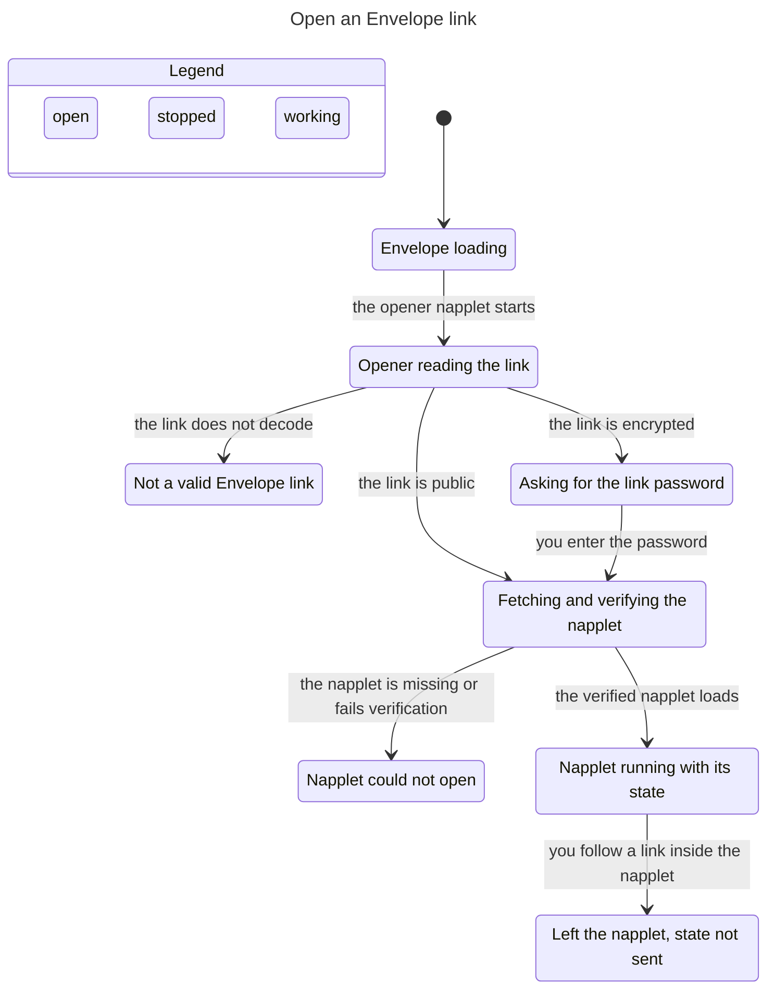

# Envelope verification

| Skill | What it checks | Tool |
| --- | --- | --- |
| [verify-envelope-opener](../../.claude/skills/verify-envelope-opener/SKILL.md) | Launch state reaches only the verified target; one link mounts one target | TLA+ / TLC, 9 states |
| [verify-envelope-fragment](../../.claude/skills/verify-envelope-fragment/SKILL.md) | Every encodable link opens to the same request; corrupted links are refused | 3,000 generated links per run against `src/fragment.js` |

The opener model found two bugs, now fixed with tests:

1. **State posted to a navigated frame.** Every iframe `load` re-posted the launch state with target origin `'*'`. After a user followed a link inside a napplet, the next page received the state (commit a1111b0).
2. **Repeated open requests remounted the target.** A second `opener.open` resolved the pointer again and replaced a target that already had its state (commit c166475).

## Open an Envelope link

Generated with pstack `/statechart` from [OpenLink.tla](flows/open-link/OpenLink.tla) ([TLC report](flows/open-link/report.md)). The chart leaves out the wrong-password retry, which stays on the password screen.

